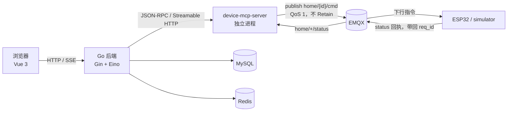
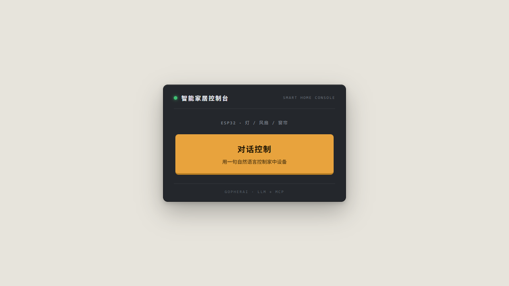
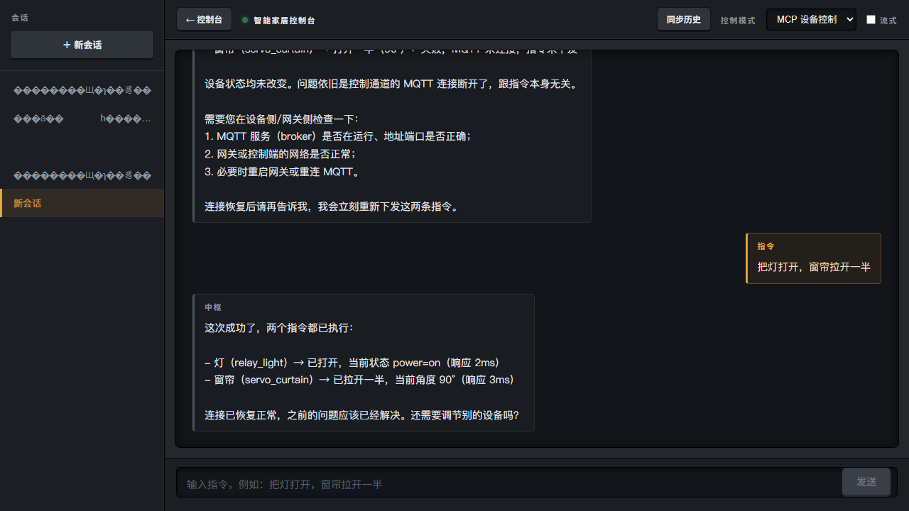

# GopherAI — 基于大语言模型与 MCP 协议的智能家居控制系统

用自然语言控制 ESP32 执行器。用户说「把灯打开，窗帘拉开一半」，大模型输出工具调用意图，经 [MCP](https://modelcontextprotocol.io) 协议交由独立的 MCP Server 转换为 MQTT 指令下发到设备，并**等待设备真实回执**后再回复用户。

> **当前状态**：软件部分（Go 后端 / Vue 前端 / MCP Server / 虚拟设备节点）已完成并联调通过。ESP32 固件尚未实现，设备侧由 `cmd/simulator` 顶替，固件落地后后端无需改动。

## 系统架构



一次控制的完整链路：

```
用户提问
 → 后端调用 LLM（附带 tools/list 自动发现的工具定义）
 → LLM 返回 control_device(device_id, action, angle)
 → MCP Client → MCP Server：参数校验 → 节点离线则立即失败 → 生成 req_id → 发布指令
 → EMQX → 设备执行 → 回执 status（原样带回 req_id）
 → MCP Server 按 req_id 命中挂起表（超时 3s）
 → 工具结果回灌 LLM → 自然语言回复「灯已打开，窗帘已拉到一半」
```

## 核心特性

| 特性 | 实现要点 |
|---|---|
| 自然语言控制 | 原生 Tool Calling 多轮循环，`tools/list` 自动发现工具，单轮可下发多个设备指令 |
| 标准化设备接入 | 设备能力以独立 MCP Server 暴露，第三方 MCP 客户端（如 MCP Inspector）可直接复用 |
| 真实执行回执 | 指令携带 `req_id`，回执匹配成功才回复；**超时返回「状态未知」而非「失败」**，避免误报 |
| 离线快速失败 | 节点在线状态由 MQTT Last Will 维护，明确离线时直接报错，不空等 3s |
| 抗幻觉约束 | 工具系统提示强制「设备状态变更必须调用 `control_device`，不得根据历史推断成功」 |
| 有界上下文 | 三层记忆：L1 近期窗口 + L2 滚动摘要 + L3 用户长期记忆，上下文规模与对话轮数解耦 |
| 流式响应 | SSE 逐帧下发，首帧携带 `sessionId`，结束发 `data: [DONE]` |

## 技术栈

| 模块 | 技术 |
|---|---|
| Web 框架 | Gin |
| LLM 框架 | CloudWeGo Eino（OpenAI 兼容接口） |
| MCP | mark3labs/mcp-go v0.43（Streamable HTTP） |
| 消息中间件 | EMQX 5.8 |
| Go MQTT 客户端 | paho.mqtt.golang |
| 持久化 | MySQL 8（GORM + AutoMigrate）、Redis |
| 前端 | Vue 3 + Element Plus + Axios |
| ESP32 固件 | Arduino 框架 + PubSubClient + ArduinoJson（**待实现**） |

## 快速开始

### 环境要求

- Go 1.24+
- Node.js 18+（Vue CLI 5）
- Docker（用于 MySQL / Redis / EMQX）

### 1. 启动中间件

```bash
docker compose up -d
```

| 服务 | 端口 | 说明 |
|---|---|---|
| EMQX MQTT | `1883` | WebSocket 是 `8083`，Dashboard 是 `18083` |
| EMQX Dashboard | `18083` | 默认 admin / public，首次登录需改密 |
| MySQL | `3307` | 映射自容器 3306，宿主 3306 可能被本机 MySQL 占用 |
| Redis | `6380` | 映射自容器 6379 |

### 2. 配置

```bash
cp config/config.toml.example config/config.toml   # 数据库账号密码等
cp .env.example .env                               # 模型密钥等
```

`.env` 至少需要 `OPENAI_API_KEY`（需支持 Tool Calling）。`DEEPSEEK_API_KEY` 可选，用于会话摘要与长期记忆提取，不配置时服务照常启动。

### 3. 启动后端与前端

```bash
./start.sh all          # 编译后端 + 启动前端；也可只用 ./start.sh 启动后端
```

后端 `http://127.0.0.1:9090`，前端 `http://127.0.0.1:8080`（端口被占用时会自动递增）。

### 4. 启动 MCP Server 与虚拟设备

```bash
go run ./cmd/device-mcp-server     # 端点 http://localhost:8081/mcp
go run ./cmd/simulator             # 虚拟 ESP32 节点 esp32_01
```

在聊天界面把模式切到「MCP 设备控制」，输入「把灯打开，窗帘拉开一半」即可。

## MCP 工具

| 工具 | 参数 | 说明 |
|---|---|---|
| `list_devices` | 无 | 列出可控设备：名称、中文别名、支持的 action 与参数范围 |
| `control_device` | `device_id`（枚举）、`action`（枚举）、`angle`（整数 0–180，选填） | 下发指令并等待回执，返回真实结果与设备响应耗时 |

参数为扁平结构，取值在 JSON Schema 上做枚举与范围约束，服务端二次校验。

### 支持的设备

| device_id | 别名 | action | 参数 |
|---|---|---|---|
| `relay_light` | 灯 / 电灯 / 台灯 / 照明 | `on` / `off` | 无 |
| `relay_fan` | 风扇 / 电扇 | `on` / `off` | 无 |
| `servo_curtain` | 窗帘 / 帘子 | `set_angle` | `angle`：0 全关，180 全开 |

### 直接调用工具（不经聊天界面）

```bash
go run ./cmd/mcp-cli tools                              # 列出工具
go run ./cmd/mcp-cli list                               # 列出设备
go run ./cmd/mcp-cli control relay_light on             # 控制设备
go run ./cmd/mcp-cli -url http://localhost:18081/mcp control servo_curtain set_angle 90
```

> `-url` 必须写在子命令**前面**。

## 目录结构

```
main.go                    后端入口
router/ controller/ service/   HTTP 层：路由 → handler → 业务编排（含 SSE 写流）
dao/ model/                数据层：GORM 实体与 CRUD
pkg/devproto/              MQTT 协议定义（Topic、消息结构）
pkg/device/                设备注册表、参数校验、指令下发与回执匹配（Commander）
pkg/memory/                三层记忆：窗口、滚动摘要、长期记忆、上下文组装
common/aihelper/           LLM 对话 + 多轮 Tool Calling + 会话管理
common/mcp/server|client/  MCP 工具定义 / MCP 客户端
common/mqtt/               MQTT 连接管理
common/messagewriter/      消息异步批量落库
cmd/device-mcp-server/     MCP Server 进程入口
cmd/simulator/             虚拟 ESP32 节点（含故障注入）
cmd/mcp-cli/ cmd/mcp-chat/ 联调工具
firmware/                  ESP32 固件（待实现）
```

## 故障注入与联调

`cmd/simulator` 内置测试开关，用于验证超时与离线分支：

| 参数 | 场景 |
|---|---|
| `-drop-status` | 节点在线但不回执 → 验证 3s 超时返回「状态未知」 |
| `-status-delay 5s` | 回执迟到 → 验证迟到回执被丢弃 |
| `-anomaly-rate` | 上报异常的传感器数据 |
| `-crash-after` | 模拟断电掉线 → 验证 Last Will 离线快速失败 |

注意：`ctrl+c` 会优雅下线（device 主动发布离线），要验证超时必须用 `-drop-status`，`taskkill /F` 只会触发 LWT。

## 截图

| 控制台 | 对话控制 |
|---|---|
|  |  |

## 已知限制

- 无鉴权，单人本机使用（MVP 设计）
- 只有下行控制链路，不采集、不存储传感器数据，无自动联动
- `messagewriter` 异步批量落库，进程崩溃会丢失未 flush 的消息（≤500ms 窗口）
- ESP32 固件未实现，硬件部分尚未联调

## 相关文档

- [design.md](design.md)：系统设计、协议、开发阶段
- [memory-design.md](memory-design.md)：三层记忆模块设计
- [openspec/](openspec)：能力规格与变更提案
- [AGENTS.md](AGENTS.md)：端口约定、进程清理与联调踩坑记录
