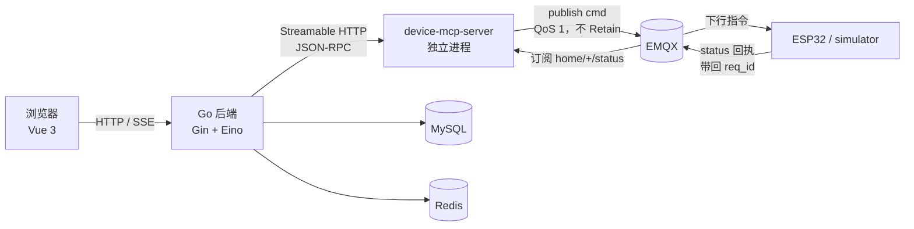

# 基于大语言模型与 MCP 协议的智能家居控制系统（设计文档）

> 版本：v5
> 本文件只描述**系统架构与技术方案**：解决什么问题、用什么技术、协议怎么定、链路怎么走。
> 开发进度、硬件实施、测试计划与分支约定见 [roadmap.md](roadmap.md)。
>
> 范围：只做**下行控制链路**——用户用自然语言下指令，LLM 通过 MCP 工具控制 ESP32 上的执行器。不做传感器数据采集、存储、告警与自动联动（模拟器会周期性上报传感器数据以贴合真实节点，但服务端不消费）。

---

## 一、问题与方案

| 问题 | 解决方式 |
| :--- | :--- |
| **交互门槛高**：传统智能家居依赖 App 按钮或固定口令，说法稍有变化就识别不了 | 引入**大语言模型**，支持口语化、一句多设备的指令，例如"把灯打开，窗帘拉开一半" |
| **设备接入不统一**：工具定义与业务逻辑耦合在主程序里，新增设备要改代码 | 采用 **MCP 协议**，把设备控制能力封装为**独立进程提供的标准工具**，支持工具自动发现、跨客户端复用 |

### 主要创新点

1. **自然语言控制**：无需记忆固定指令，支持模糊表达与一句多设备。
2. **基于 MCP 的标准化设备接入**：设备能力以独立 MCP Server 暴露，第三方 MCP 客户端可直接复用。
3. **可靠的指令回执**：指令带 `req_id`，等待设备真实执行结果后再回复用户；设备离线时立即告知（Last Will）。

---

## 二、术语

| 术语 | 在本项目中的作用 |
| :--- | :--- |
| **MQTT / EMQX** | ESP32 与后端之间的消息协议 / 消息服务器（Broker） |
| **QoS** | 指令与回执使用 QoS 1，保证至少送达一次 |
| **Retain** | Broker 保留 Topic 最后一条消息，新订阅者连上立即拿到设备最新状态 |
| **Last Will** | 设备连接时预先登记的"遗嘱"，异常掉线时由 Broker 代发离线消息 |
| **Tool Calling** | LLM 输出"要调用哪个函数及参数"的结构化结果 |
| **MCP** | 规范 LLM 应用如何发现（`tools/list`）和调用（`tools/call`）外部工具的协议 |
| **MCP Server** | 独立进程 `device-mcp-server`，把工具调用转换为 MQTT 指令 |
| **MCP Client** | 集成在 Go 后端（`aihelper`）中，代 LLM 发起工具调用 |
| **SSE** | 流式回复：逐 chunk 下发 `data: {"delta": "..."}`，结束发 `data: [DONE]` |
| **水位线** | 会话摘要已覆盖的消息条数 `digested_count`，用于增量压缩而非逐条标记 |

---

## 三、技术选型

| 模块 | 技术 | 位置 |
| :--- | :--- | :--- |
| Web 框架 | Gin | `router/`、`controller/` |
| LLM 框架 | CloudWeGo Eino（OpenAI 兼容） | `common/aihelper` |
| MCP | mark3labs/mcp-go v0.43（Streamable HTTP） | `common/mcp/server`、`common/mcp/client` |
| 消息中间件 | EMQX 5.8（Docker） | `docker-compose.yml` |
| Go MQTT 客户端 | paho.mqtt.golang | `common/mqtt` |
| ESP32 固件 | Arduino 框架 + PubSubClient + ArduinoJson + ESP32Servo | `firmware/`（待实现） |
| 前端 | Vue 3 + Element Plus + Axios（SSE 用原生 `fetch` 读取流） | `vue-frontend/` |
| 持久化 | MySQL 8（GORM + AutoMigrate）、Redis | `common/mysql`、`common/redis`、`dao/` |
| 流式输出 | SSE（`http.Flusher` 逐帧 flush） | `service/session/` |
| 摘要模型 | DeepSeek（OpenAI 兼容，独立于会话模型，未配置则降级） | `common/aihelper/summarizer.go` |

### MCP 与 Function Calling 的取舍

Tool Calling 是 LLM 的能力（输出调用意图），MCP 是工具的提供与发现方式，MCP 建立在 Tool Calling 之上。

| 维度 | 纯 Function Calling | MCP（本系统） |
| :--- | :--- | :--- |
| 工具定义位置 | 硬编码在主程序 | 独立进程 |
| 新增工具 | 改代码、重新编译、重启 | Server 注册，Client 通过 `tools/list` 自动发现 |
| 复用 | 仅本系统 | 任何 MCP 客户端（如 MCP Inspector）可直连 |
| 代价 | 低延迟、低复杂度 | 多一次进程间往返 |

```
Go 后端（MCP Client）
      ↓ JSON-RPC / Streamable HTTP（http://localhost:8081/mcp）
device-mcp-server（MCP Server，独立进程）
      ↓ MQTT publish
EMQX → ESP32
```

---

## 四、系统架构与分层



代码分层：

```
router/ controller/ service/   HTTP 层：路由 → handler → 业务编排（含 SSE 写流）
dao/ model/                    数据层：GORM 实体与 CRUD（session / message / digest / usermemory）
pkg/devproto                   MQTT 协议定义（Topic、消息结构），模拟器 / MCP Server 共用
pkg/device                     领域：设备注册表与参数校验、指令下发与回执匹配（Commander）
pkg/memory                     领域：L1 窗口 + L2 摘要 + L3 长期记忆、上下文组装与预算（见 memory-design.md）
common/mqtt                    MQTT 连接管理，实现 Publisher 接口
common/messagewriter           消息异步批量落库（1024 缓冲 / 50 条 / 500ms）
common/mcp/server              MCP 工具定义（list_devices、control_device）
common/mcp/client              MCP 客户端，供 aihelper 调用
common/aihelper                LLM 对话 + 多轮 Tool Calling + 会话管理（manager）
cmd/device-mcp-server          MCP Server 进程入口
cmd/simulator                  虚拟 ESP32 节点（含故障注入）
cmd/mcp-cli / cmd/mcp-chat     联调工具：直接调用工具 / 命令行对话
firmware/                      ESP32 固件（PlatformIO 工程）—— 待实现，目录尚未创建
```

**依赖方向**：`service → common/aihelper → pkg/memory → dao`；设备侧 `cmd/device-mcp-server → common/mcp/server → pkg/device → common/mqtt → pkg/devproto`。`pkg/memory` 通过 `Summarizer` 接口反向调用 LLM，避免循环 import。

---

## 五、通信协议与开发规范

### 1. MQTT Topic

```
home/{device_id}/cmd        下行：控制指令（QoS 1，不 Retain，防止重连时重复执行）
home/{device_id}/status     上行：执行回执（QoS 1，Retain）
home/{node_id}/status       上行：节点在线状态（QoS 1，Retain，含 Last Will）
home/{node_id}/data         上行：传感器上报（仅模拟器使用，服务端不消费）
```

### 2. 消息格式

```json
// 指令（req_id 由 MCP Server 生成）
{"device_id": "relay_light", "action": "on", "params": {}, "req_id": "a1b2"}
{"device_id": "servo_curtain", "action": "set_angle", "params": {"angle": 90}, "req_id": "c3d4"}

// 回执（原样带回 req_id）
{"device_id": "relay_light", "action": "on", "req_id": "a1b2", "success": true, "state": {"power": "on"}, "ts": 1729400000}
{"device_id": "servo_curtain", "action": "set_angle", "req_id": "c3d4", "success": false, "error": "angle 200 out of range [0,180]", "state": {"angle": 90}, "ts": 1729400000}

// 节点在线状态
{"online": true, "ts": 1729400000}
{"online": false, "reason": "unexpected_disconnect"}   // Last Will
{"online": false, "reason": "graceful_shutdown"}
```

### 3. 设备与 action

| device_id | 名称（别名） | action | 参数 |
| :--- | :--- | :--- | :--- |
| `relay_light` | 灯（电灯/台灯/照明） | `on` / `off` | 无 |
| `relay_fan` | 风扇（电扇） | `on` / `off` | 无 |
| `servo_curtain` | 窗帘（帘子） | `set_angle` | `angle`：0–180，0° 全关，180° 全开 |

> 所有设备挂载在节点 `esp32_01`，使用静态清单注册。

### 4. MCP 工具

| 工具名 | 参数 | 作用 |
| :--- | :--- | :--- |
| `list_devices` | 无 | 列出可控设备（名称、别名、支持的 action 与参数范围） |
| `control_device` | `device_id`（枚举）、`action`（枚举）、`angle`（选填，整数 0–180） | 下发指令，等待设备回执后返回真实结果与响应耗时 |
| `get_device_state` | `device_id`（枚举） | 只读：返回设备最近一次上报的状态与上报时间；节点离线时提示状态可能已过期 |

> 参数采用扁平结构，便于 LLM 正确生成并在 schema 上约束取值；MCP Server 内部再转换为 MQTT 的 `params`。
> 工具清单由服务端注册表动态生成，客户端通过 `tools/list` 自动发现，新增设备不需要改提示词。
>
> `get_device_state` 读的是 Commander 的状态缓存（设备初始上报 + 每次执行回执都会刷新），**不额外下发指令**。缓存未命中时明确返回"暂无状态记录"而非编造，避免模型把"没查到"说成"已关闭"。

---

## 六、控制链路

```
用户："把灯打开，窗帘拉开一半"
→ aihelper 调用 LLM（附带 tools/list 拿到的工具）
→ LLM 输出：
     control_device(device_id="relay_light", action="on")
     control_device(device_id="servo_curtain", action="set_angle", angle=90)
→ MCP Client → Streamable HTTP → MCP Server
→ MCP Server：校验参数 → 节点离线则立即失败 → 生成 req_id → publish home/{device_id}/cmd
→ EMQX → ESP32 执行 → 回执 home/{device_id}/status（带回 req_id）
→ MCP Server 按 req_id 匹配回执（超时 3s）
→ 工具结果回填给 LLM → 生成自然语言回复："灯已打开，窗帘已拉到一半"
```

### 关键设计

| 问题 | 处理 |
| :--- | :--- |
| MCP 同步调用 vs MQTT 异步消息 | MCP Server 启动时常驻订阅 `home/+/status`，用 `req_id` → channel 挂起表匹配回执 |
| Retain 旧回执、迟到回执 | 不在挂起表中的 `req_id` 一律丢弃 |
| 回执超时 | 返回"未收到确认，状态未知"，而不是"失败"（设备可能已执行） |
| 设备离线 | 通过节点 Last Will 维护在线状态，离线时立即返回错误，不等超时；状态未知时照常下发 |
| 非法参数 | schema 枚举/范围约束 + Server 端校验，以 MCP 工具错误返回，LLM 可读原因并修正 |
| 模型幻觉 | 工具系统提示强制"设备状态变更必须先调 `control_device`，不得根据历史或工具描述推断成功" |
| 时延统计 | 每次调用输出 `device_control` 结构化日志（`req_id`、`latency_ms`、`result`），供论文时延测试 |

---

## 七、会话记忆与上下文管理

> 详细设计与字段级说明见 `memory-design.md`，此处只记录已落地的结论（L1/L2/L3 均已实现）。

| 层 | 内容 | 存储 | 上限 |
| :--- | :--- | :--- | :--- |
| L1 近期窗口 | 未被摘要覆盖的原始消息 | 内存，首次访问会话时懒加载 | `windowHardLimit` 条 |
| L2 会话摘要 | 旧消息的滚动压缩结果 | `t_session_digest`（`digested_count` 水位线 + `version` 乐观锁） | `digestMaxChars` 字 |
| L3 长期记忆 | 用户偏好、身份、长期事实 | `t_user_memory` + `t_session_extract`（按用户一条活跃记录） | `userMemoryMaxChars` 字 |

- 核心约束：DB 存全量，喂给 LLM 的上下文 = 摘要 + 窗口，**与对话轮数解耦**，不会因轮数增长而超窗口。
- 摘要与长期记忆提取都在回复返回后**异步**执行，不增加用户等待；失败则窗口不变、下轮重试，先落库再改内存。
- 摘要固定用 DeepSeek：`MCPModel` 会把最后一条消息改写为工具调用提示词，用会话自身模型做摘要会被污染。未配置 `DEEPSEEK_API_KEY` 时自动降级为纯窗口模式。
- 启动不再全量加载消息（原 `readDataFromDB` 已移除），加载量为 1 行摘要 + 最近 `windowHardLimit` 条消息。

---

## 八、联调与测试工具

| 工具 | 作用 | 用法 |
| :--- | :--- | :--- |
| `cmd/simulator` | 虚拟 ESP32 节点，含传感器上报与故障注入 | `-drop-status`（在线但不回执）、`-status-delay 5s`（回执迟到）、`-anomaly-rate`（异常数据） |
| `cmd/mcp-cli` | 直接调用 MCP 工具，绕过聊天界面验证工具层行为 | `go run ./cmd/mcp-cli control relay_light on` |
| `cmd/mcp-chat` | 命令行对话，验证 LLM 多轮工具调用 | — |
| MCP Inspector | 第三方客户端，验证工具可被外部复用 | 连接 `http://localhost:8081/mcp` |

> 端口约定、进程清理与常见坑见 `AGENTS.md`；判断工具行为一律用 `mcp-cli`，不要看聊天界面的二次包装话术。
> 具体测试项、指标口径与验收标准见 [roadmap.md](roadmap.md)。

---

## 九、相关文档

| 文档 | 内容 |
| :--- | :--- |
| [roadmap.md](roadmap.md) | 开发路线图：状态、里程碑、硬件计划、测试方案、分支约定 |
| [memory-design.md](memory-design.md) | 三层记忆模块设计（字段级） |
| [openspec/](openspec) | 能力规格与变更提案 |
| [AGENTS.md](AGENTS.md) | 端口、进程清理与联调踩坑记录 |
| [README.md](README.md) | 快速开始与工具清单 |
