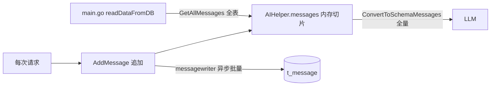
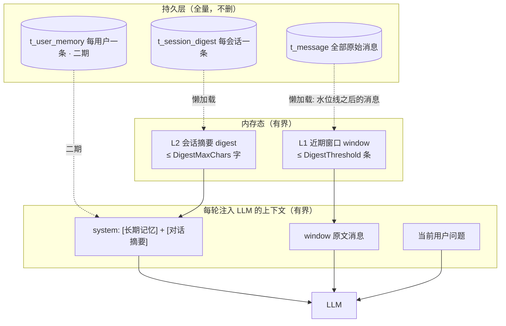
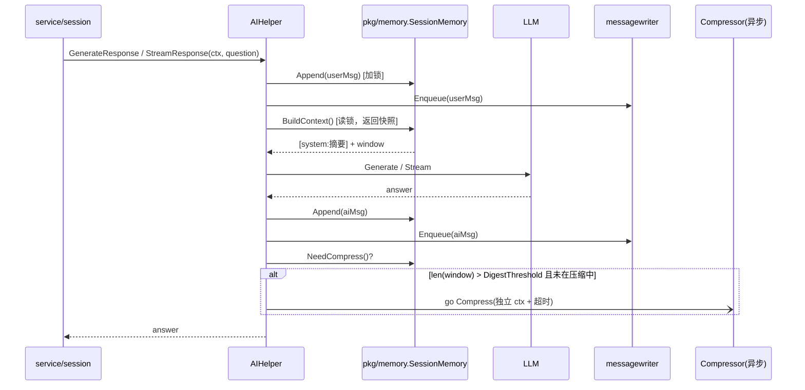
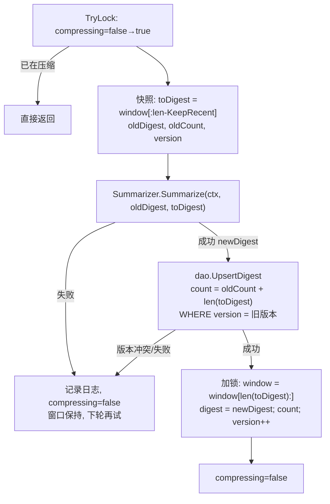
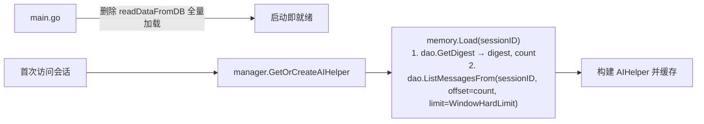

# GopherAI-v2 记忆模块重构 · 架构设计文档

> 参考：`3000-agent` 的 memory 模块（L2 会话摘要 `t_conversation_digest` + L3 长期记忆 `t_memory`）
> 状态：**待评审**，确认后再开始编码

---

## 1. 背景与问题

### 1.1 现状链路



### 1.2 问题清单

| # | 问题 | 位置 | 影响 |
|---|------|------|------|
| P1 | 每轮把会话**全部历史**发给 LLM | `aihelper.go` `GenerateResponse/StreamResponse` | Token 线性增长 → 响应变慢、成本上升，最终超出模型上下文窗口直接报错 |
| P2 | `AIHelper.messages` 无上限增长 | `aihelper.go` | 进程内存随消息总量线性增长 |
| P3 | 启动全表加载 `GetAllMessages()` | `main.go` | 数据量大时启动慢、内存峰值高 |
| P4 | `AddMessage` 写切片未加锁，而读时加了 `RLock` | `aihelper.go` | 并发请求同一会话存在 data race |
| P5 | 历史接口按 `i%2` 判断用户/AI 消息 | `service/session` `GetChatHistory` | 消息不严格交替（如生成失败）时角色错乱 |
| P6 | 会话列表来自内存 `manager.GetUserSessions` | `service/session` | 一旦改为懒加载，列表会缺失 |

**根因**：系统只有"存储"，没有"记忆管理"——DB 存全量没问题，问题是**喂给 LLM 的上下文与对话长度耦合**。

---

## 2. 参考设计提炼（3000-agent）

| 设计点 | 3000-agent 做法 | 本项目是否采用 |
|--------|----------------|----------------|
| 近期窗口 | 摘要后保留最近 `DigestKeepRecent=20` 条原文 | ✅ 采用 |
| 会话滚动摘要 | 未摘要消息 > 50 条触发；旧摘要 + 待压缩消息 → 新摘要（≤500 字），整体替换；每会话一条记录 | ✅ 采用（核心） |
| 已摘要标记 | 消息表 `is_digest` 字段，逐条 UPDATE | ⚠️ **改良**：改用摘要表上的"位置水位线"，见 §4.2 |
| 摘要注入 | 包装为 `[对话摘要]` 前缀的**单条** system message 放在消息头部 | ✅ 采用 |
| 长期记忆 | user/project 两级，每级一条活跃记录，增量整合，注入时 `maxChars` 截断 | ✅ 简化为 **user 级**（本项目无 project 概念），作为第二期 |
| 摘要失败 | 降级使用全部未摘要消息 | ⚠️ **改良**：增加硬上限兜底，见 §5.4 |
| 触发时机 | 请求路径内**同步**生成摘要 | ⚠️ **改良**：回复完成后**异步**生成，不增加用户等待 |

核心思想一句话：**DB 存全量，LLM 只看"摘要 + 近期窗口"，上下文大小有界、与轮数无关。**

---

## 3. 目标架构

### 3.1 三层记忆模型



| 层 | 内容 | 生命周期 | 上限 |
|----|------|----------|------|
| L1 近期窗口 | 未被摘要覆盖的原始消息 | 会话内 | 正常 ≤ `DigestThreshold`，异常兜底 ≤ `WindowHardLimit` |
| L2 会话摘要 | 旧消息的滚动压缩 | 会话内 | `DigestMaxChars` |
| L3 长期记忆（二期） | 用户偏好/身份/长期事实 | 跨会话 | `UserMemoryMaxChars` |

**上下文上界** ≈ `UserMemoryMaxChars + DigestMaxChars + WindowHardLimit × 单条长度`，并由 `ContextMaxChars` 最终兜底截断。

### 3.2 分层与目录（对齐"三横两竖"规则，兼容现有目录）

现有项目使用 `controller/ common/` 目录，本次**不做目录大迁移**，仅新增代码按规则落位：

```
GopherAI-v2/
├── controller/session/          # 表现层（不改动核心逻辑）
├── service/session/             # 应用编排：GetChatHistory / 会话列表改走 DB
├── common/aihelper/             # 现有会话编排器：持有 Memory，组装上下文
│   ├── aihelper.go              #   [改] messages → *memory.SessionMemory
│   ├── manager.go               #   [改] GetOrCreate 时懒加载记忆
│   └── summarizer.go            #   [新] 用 OpenAI 模型实现 memory.Summarizer
├── pkg/memory/                  # [新] 领域核心：记忆规则，不依赖上层
│   ├── config.go                #   阈值参数
│   ├── session_memory.go        #   L1 窗口 + L2 摘要状态、切分规则、并发控制
│   ├── compressor.go            #   滚动摘要流程（调用 Summarizer 接口）
│   ├── assembler.go             #   上下文组装 + 预算截断
│   ├── prompt.go                #   摘要提示词模板
│   └── *_test.go                #   单测（fake Summarizer）
├── dao/digest/digest.go         # [新] t_session_digest CRUD（乐观锁更新）
├── dao/message/message.go       # [改] 新增按水位线/分页查询
└── model/digest.go              # [新] SessionDigest 实体
```

**依赖方向**：`service → common/aihelper → pkg/memory → dao`。
`pkg/memory` 通过 **`Summarizer` 接口**调用 LLM，由 `aihelper` 注入实现，避免 `pkg → aihelper` 反向依赖造成循环 import。

---

## 4. 数据模型

### 4.1 新表 `t_session_digest`

```go
// model/digest.go
type SessionDigest struct {
    ID            uint      `gorm:"primaryKey;autoIncrement"`
    SessionID     string    `gorm:"uniqueIndex;type:varchar(36);not null"`
    Content       string    `gorm:"type:text;not null"`      // 滚动摘要正文
    DigestedCount int       `gorm:"not null;default:0"`      // 水位线：该会话按 id 升序的前 N 条消息已被摘要覆盖
    Version       int       `gorm:"not null;default:0"`      // 乐观锁版本号，每次整合 +1
    CreatedAt     time.Time
    UpdatedAt     time.Time
}
func (SessionDigest) TableName() string { return "t_session_digest" }
```

加入 `mysql.migration()` 的 `AutoMigrate`。**`t_message` 表结构不变。**

### 4.2 为什么用"水位线"而不是 3000-agent 的 `is_digest` 标记

| 对比 | `is_digest` 逐条标记 | `DigestedCount` 水位线（本方案） |
|------|---------------------|-------------------------------|
| 每次摘要的写操作 | UPDATE N 条消息 + 写摘要，两张表需要事务 | **只写一行摘要**，天然原子 |
| 与异步批量写入器的兼容 | 消息可能尚未落库、还没有 ID，无法标记 | 只依赖消息**顺序**，不依赖 ID 是否已生成 |
| 加载未摘要消息 | `WHERE is_digest=false` | `ORDER BY id LIMIT ? OFFSET DigestedCount` |
| 前提 | 无 | 消息**只追加不删除**，且落库顺序 = 产生顺序 |

前提成立性：`messagewriter` 是**单协程**按入队顺序 `CreateInBatches`，自增 ID 与产生顺序一致；项目无删除消息功能。
已知风险：`messagewriter.flush` 失败会**丢弃整批**消息，导致 DB 位置与内存位置错位（摘要内容本身不受影响，只影响重启后窗口起点偏移几条）。聊天场景可接受；如需严格，可后续把 flush 失败改为重试。

### 4.3 二期新表 `t_user_memory`（本期不实现，仅预留设计）

```go
type UserMemory struct {
    ID        uint
    UserName  string `gorm:"uniqueIndex;type:varchar(20)"`
    Content   string `gorm:"type:text"`   // 整合后的完整长期记忆
    Version   int
    UpdatedAt time.Time
}
```

---

## 5. 核心流程

### 5.1 单轮对话（同步 / 流式一致）



要点：
- 摘要在**回复返回之后异步**执行，用户无感知；由于窗口有阈值，摘要晚几轮完成不会导致上下文失控。
- 生成失败时（LLM 报错）**不追加 AI 消息**，保持现有语义。

### 5.2 滚动摘要（Compressor）



关键约束：
1. **先落库再改内存**：DB 写失败则内存不变，不会出现"内存已丢弃消息但摘要没存"的数据丢失。
2. **只裁剪头部**：压缩期间新消息只会追加到窗口尾部，所以成功后裁掉前 `len(toDigest)` 条即可，不会误删新消息。
3. **单会话单飞**：`compressing` 标志位（`atomic.Bool`）保证同一会话同时只有一个压缩任务。
4. **乐观锁**：`UPDATE ... WHERE session_id=? AND version=?`，防止多实例部署时并发覆盖。
5. **独立 context**：`context.WithTimeout(context.Background(), SummarizeTimeout)`，不受 HTTP 请求取消影响（同 3000-agent）。

### 5.3 摘要器（Summarizer）

```go
// pkg/memory
type Summarizer interface {
    Summarize(ctx context.Context, oldDigest string, msgs []Turn) (string, error)
}
```

- 实现放在 `common/aihelper/summarizer.go`，**固定使用 DeepSeek**（OpenAI 兼容协议），全局单例。
  - 环境变量：`DEEPSEEK_API_KEY`（必填，缺失则不做摘要，仅靠窗口上限兜底）、`DEEPSEEK_BASE_URL`（默认 `https://api.deepseek.com`）、`DEEPSEEK_MODEL_NAME`（默认 `deepseek-chat`）
  - 原因：`MCPModel.GenerateResponse` 会把最后一条消息改写为工具调用提示词，若用会话自身模型做摘要会被污染。
- 提示词（`pkg/memory/prompt.go`，参考 3000-agent `digest.md` 改为通用对话场景）：
  - 重点保留：用户身份/偏好/约束、已确认的结论与决策、未完成的任务、关键事实与数据
  - 丢弃：寒暄、被推翻的中间方案、重复内容
  - 若提供旧摘要则整合进去，冲突以新信息为准
  - 总长度 ≤ `DigestMaxChars`，直接输出正文
- 返回结果再做一次 rune 级硬截断，防止模型不守长度。

### 5.4 上下文组装与预算（Assembler）

```
messages = [
  system: "[对话摘要]\n以下是之前对话的摘要，请基于这些背景继续对话：\n\n{digest}",   // 有摘要才加
  ...window 原文（含本轮用户问题）
]
```

预算规则（按 rune 估算，无需引入 tokenizer）：
1. 摘要单独截断到 `DigestMaxChars`。
2. 窗口条数超过 `WindowHardLimit`（摘要连续失败的兜底）时，只取最近 `WindowHardLimit` 条。
3. 总字符数超过 `ContextMaxChars` 时，从窗口**最旧**的消息开始丢弃，**至少保留本轮用户问题**。
4. 丢弃仅影响本次注入，不修改内存窗口和 DB。

### 5.5 启动与懒加载



- 加载量与历史总量无关，最多 `1 行摘要 + WindowHardLimit 条消息`。
- 若水位线之后的消息多于 `WindowHardLimit`（历史数据首次迁移的场景），加载时取最近 `WindowHardLimit` 条，并在首轮对话后由压缩流程逐步收敛。
- **存量数据迁移**：老会话没有摘要记录，`count=0`，按上一条规则只加载最近一段，无需离线脚本。

### 5.6 历史与会话列表（修复 P5、P6）

| 接口 | 现状 | 改为 |
|------|------|------|
| `GetChatHistory` | 读内存 `helper.GetMessages()`，`i%2` 判断角色 | 读 DB `dao/message.GetMessagesBySessionID`（已存在），使用 `msg.IsUser`；可选分页 |
| `GetUserSessionsByUserName` | 读内存 manager | 读 DB `dao/session.GetSessionsByUserName`（已存在），并返回真实 `Title` |

> 注意：消息异步落库有 ≤500ms 延迟，刚发送完立即拉历史可能缺最后 1~2 条。前端当前流程是本地追加消息，不依赖实时拉取，可接受。

---

## 6. 并发模型

| 资源 | 保护方式 |
|------|----------|
| `SessionMemory.window / digest / count / version` | `sync.RWMutex`；`Append`、`ApplyCompression` 写锁，`BuildContext`、`Snapshot` 读锁并**返回拷贝** |
| 压缩任务互斥 | `atomic.Bool compressing`（CAS） |
| 多实例并发写摘要 | DB 乐观锁 `version` |
| LLM 调用 | **不持有任何锁**（避免长时间阻塞同会话其他请求） |

同时修复 P4：`AIHelper` 不再直接操作切片，所有读写经过 `SessionMemory` 的加锁方法。

---

## 7. 配置项

`config.toml` 新增（`config.go` 增加 `MemoryConfig`，缺省值在 `pkg/memory/config.go` 兜底）：

```toml
[memoryConfig]
digestThreshold   = 40     # 窗口消息数超过该值触发压缩（≈20 轮）
keepRecent        = 16     # 压缩后保留的原文消息数（≈8 轮）
windowHardLimit   = 80     # 摘要连续失败时注入的最大消息数兜底
digestMaxChars    = 800    # 摘要最大字符数
contextMaxChars   = 24000  # 单次注入上下文总字符上限
summarizeTimeoutS = 60     # 摘要调用超时（秒）
```

> 与 3000-agent（50/20）相比阈值略小：通用问答单条消息更长，按字符预算折算后取值。

---

## 8. 接口定义（先行）

```go
// pkg/memory/session_memory.go
type Turn struct {
    IsUser  bool
    Content string
}

type SessionMemory struct { /* window []Turn; digest string; digestedCount, version int; mu; compressing */ }

func Load(ctx context.Context, sessionID string, cfg Config) (*SessionMemory, error)
func (m *SessionMemory) Append(t Turn)
func (m *SessionMemory) BuildContext() []*schema.Message          // 组装 + 预算
func (m *SessionMemory) NeedCompress() bool
func (m *SessionMemory) Compress(ctx context.Context, s Summarizer) error

// dao/digest/digest.go
func GetBySessionID(ctx context.Context, sessionID string) (*model.SessionDigest, error) // 不存在返回 nil, nil
func Upsert(ctx context.Context, d *model.SessionDigest, expectVersion int) error       // 乐观锁

// dao/message/message.go（新增）
func ListBySessionFrom(ctx context.Context, sessionID string, offset, limit int) ([]model.Message, error)
func CountBySession(ctx context.Context, sessionID string) (int64, error)
```

> `aihelper` 现有公开方法签名（`GenerateResponse/StreamResponse/AddMessage`）保持不变，service/controller 层无需改调用方式。`GetMessages()` 改为返回当前窗口快照，仅作调试用途。

---

## 9. 效果预估

以 1 轮 ≈ 2 条消息、单条平均 300 字为例：

| 对话轮数 | 现状注入字符 | 重构后注入字符 |
|----------|-------------|---------------|
| 10 轮 | ~6,000 | ~6,000（未触发压缩） |
| 50 轮 | ~30,000 | ≤ 800 + 40×300 ≈ 12,800 |
| 500 轮 | ~300,000（已超多数模型窗口） | ≤ 12,800（**恒定**） |

额外开销：每压缩一次多一次 LLM 调用（每 ~12 轮一次，异步，输入 ≈ 旧摘要 + 24 条消息）。

---

## 10. 实施计划

| 阶段 | 内容 | 涉及文件 |
|------|------|----------|
| 1 | 数据层：`SessionDigest` 实体、迁移、digest DAO、message 新查询 | `model/digest.go` `dao/digest/` `dao/message/` `common/mysql/` |
| 2 | 领域层：`pkg/memory`（窗口、压缩、组装、预算、提示词）+ 单测 | `pkg/memory/*` |
| 3 | 编排接入：`AIHelper` 改用 `SessionMemory`，`Summarizer` 实现，异步触发 | `common/aihelper/*` |
| 4 | 懒加载：去掉 `readDataFromDB` 全量加载，manager 首次访问时 `Load` | `main.go` `common/aihelper/manager.go` |
| 5 | 历史/会话列表改读 DB，修复角色判断 | `service/session/session.go` |
| 6 | 配置项接入 | `config/config.go` `config/config.toml` |
| 二期 | L3 用户长期记忆（每 N 条新消息异步提取、增量整合、注入 system） | `pkg/memory/longterm.go` `dao/usermemory/` |
| 二期 | 空闲 AIHelper 淘汰（LRU/TTL），彻底限制进程内存 | `common/aihelper/manager.go` |

---

## 11. 评审结论

1. 阈值：开发测试阶段使用小阈值（`config.toml`：6/2/12/300/8000），代码缺省值保持 40/16/80/800/24000，上线前调回。
2. 历史接口：支持分页（`page`/`pageSize`，`page=1` 为最新一页，响应含 `total`/`hasMore`）；不传 `pageSize` 返回全部，兼容现有前端。
3. 摘要模型：使用 DeepSeek。
4. 本次只做 MVP（L1+L2），L3 长期记忆与 AIHelper 淘汰下次做。
